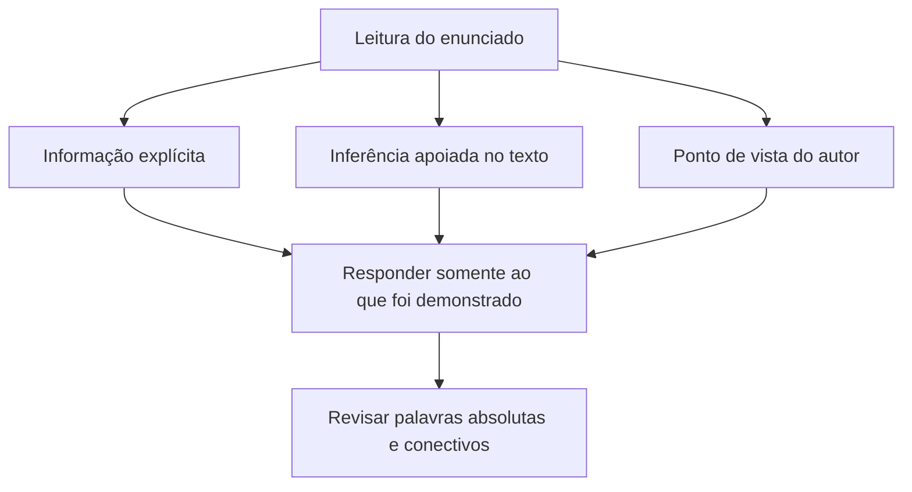

# Livro-texto · Semana 01
**26/10–01/11/2026 · Escrevente TJSP · Edital 02/2026**

## O que esta semana constrói

A habilidade central é **distinguir o que um texto afirma daquilo que apenas parece plausível**, além de ler com cuidado os direitos e garantias fundamentais. O trabalho de escrevente envolve documentos e movimentação processual; leitura sem inferências arbitrárias é essencial.

## Mapa conceitual

## Aula 1 — Informação literal e inferência

**Literal** é aquilo que está dito. **Inferência válida** é conclusão justificável por evidências textuais; não é sinônimo de palpite. Exemplo: “A audiência foi adiada por indisponibilidade da sala” permite concluir que a data mudou, mas não permite afirmar que houve ausência de parte.

**Armadilha:** confundir hipótese provável com consequência necessária.

**Fixação:** crie dois exemplos, um de fato expresso e outro de hipótese não confirmada.

## Aula 2 — Ponto de vista e argumento

Um autor pode **descrever** um problema, **defender** uma tese e **sustentá-la** com dados ou raciocínio. Diferencie posicionamento do autor de discurso atribuído a terceiros. Exemplo: “Segundo especialistas, a digitalização reduz etapas” não demonstra necessariamente a concordância irrestrita do narrador.

**Armadilha:** atribuir ao autor toda opinião citada no texto.

## Aula 3 — Coesão e conectivos

“Porém” assinala oposição; “portanto”, conclusão; “porque”, justificativa/causa conforme contexto. O conectivo muda a relação lógica, mesmo quando as palavras principais permanecem.

**Caso:** “O sistema ficou indisponível; portanto, o atendimento foi reagendado.” A segunda oração decorre da primeira. Substituir por “embora” exigiria outra construção e relação argumentativa.

## Aula 4 — Constituição: direitos e garantias

**Referência do edital:** CF, Título II, Capítulo I (direitos e deveres individuais e coletivos). Leia o art. 5º diretamente na Constituição e anote a diferença entre **igualdade perante a lei**, **acesso à Justiça**, **contraditório/ampla defesa** e **devido processo legal**.

**Caso:** uma questão afirma que o contraditório pode ser dispensado em qualquer processo administrativo. O termo “qualquer” torna a afirmação incompatível com a proteção constitucional geral. Procure no texto constitucional a redação e os limites da garantia.

## Aula 5 — Direito social, nacionalidade e administração

**Referência:** CF, Título II, Capítulos II e III; Título III, Capítulo VII, Seções I e II; art. 92. Nesta semana, faça leitura exploratória e construa um índice: **direitos sociais** não são o mesmo que **direitos individuais**; **nacionalidade** trata do vínculo jurídico-político; **administração pública** traz princípios e regras sobre agentes públicos.

Não tente decorar os três blocos de uma vez; marque os dispositivos que exigirão revisão nas semanas 02 e 03.

## Aula 6 — Primeira redação dissertativo-argumentativa

**Proposta autoral:** “Como equilibrar a ampliação dos serviços públicos digitais e o direito de acesso da população?”

Defina uma tese explícita; desenvolva dois argumentos diferentes; conclua retomando o problema sem introduzir tema novo. Produza texto **manuscrito**, legível, formal, com mais de 7 linhas autorais, e confira todas as regras do edital. Evite marcas de identificação.

### Revisão ativa

Explique cada aula em 30–60 segundos, sem olhar. Depois resolva as 12 questões da pasta e faça a redação. Compare as respostas somente ao final.

### Fontes

Edital 02/2026, Anexo VIII pp. 61–63; Constituição Federal, arts. 5º–41 (apenas os recortes expressamente descritos no Anexo VIII), e art. 92. As explicações são didáticas, não substituem a leitura legal.
